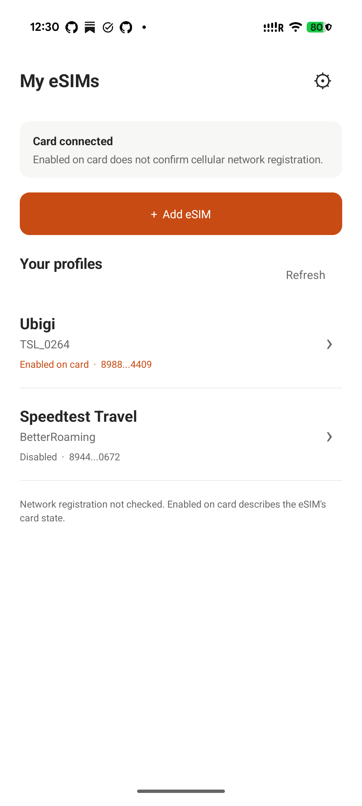
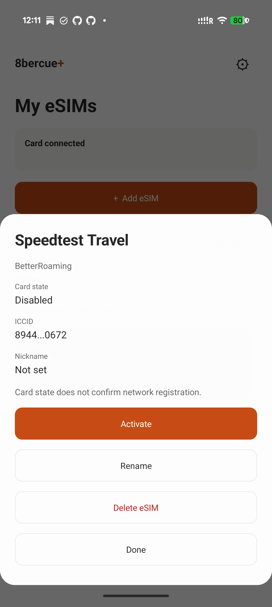

  

<h1 align="center">8bercue</h1>

An open-source eSIM manager for Android. Your profiles, on your terms.

  <a href="https://github.com/sidnvy/8bercue/releases">Download APK</a> ·
  <a href="https://github.com/sidnvy/8bercue/releases/tag/v0.19.1-beta.1">Release notes</a> ·
  <a href="https://github.com/sidnvy/8bercue/issues">Feedback</a>

Manage profiles on compatible eUICCs, including removable cards such as 5ber, from a clean Android interface. No 5ber account required.

  
  &nbsp;&nbsp;
  

## Features

- View profiles and card information.
- Rename, enable, disable and delete profiles.
- Add an eSIM by scanning a QR code, importing an image or entering an activation code.
- Connect through a computer using ADB.
- Use English or Simplified Chinese, following the system or an in-app language choice.
- Confirm installation and deletion, with recovery tools for interrupted operations.

Read-only recovery preserves uncertain-operation records and keeps changes paused while the current card is checked. See [recovery behavior](docs/READ_ONLY_RECOVERY.md).

## Get started

The APK installs on **ARM64 Android 9+**. Card management also requires a compatible eUICC and a usable HAL, Telephony or OMAPI channel with the required system permissions. Android version and ADB access alone do not guarantee card access. Available management actions depend on the connection. See [device compatibility](docs/COMPATIBILITY.md).

This version checks the actual card connection automatically: Secure Element HAL first, then Telephony, with OMAPI as another fallback. **Compatibility check** shows the selected channel and missing conditions. If several cards are readable, use **Choose card** to select the intended eUICC. No phone-brand or Android 16 admission list is used. The previous 0.18 Beta retains its older limits.

Connect once with a computer using **ADB**. No separate privilege-manager app is required. Reconnect after a reboot, app update or service termination.

1. Install the APK from [Releases](https://github.com/sidnvy/8bercue/releases).
2. Open 8bercue and choose **Connect using computer**.
3. Open **Compatibility check** and confirm the selected channel and a fresh profile list before making changes. See [testing a new phone](docs/NEW_DEVICE_CHECK.md).

On the connection screen, choose **Copy ADB command** and run it while the two-minute timer is active. The command stays the same across installations and updates; it finds the installed APK automatically. Your terminal confirms the authenticated connection or explains why it failed. If the window expires, choose **Start connection again** and rerun the same command. No Python script or separate helper app is required. With several devices attached, use `adb -s SERIAL shell` for the intended phone. Card access is checked separately after connection.

Manage the selected card from the profile list. Open a profile to turn it on/off, rename it or delete it. Switching and saving a nickname execute directly; installation and deletion require confirmation. Enabled profiles must be turned off before deletion. Connection, compatibility and recovery details are in Settings.

Currently in **Beta**. See the [release notes](https://github.com/sidnvy/8bercue/releases/tag/v0.19.1-beta.1) for setup details, migration guidance and known issues.

## Build & contribute

See [BUILDING.md](BUILDING.md) to build and sign your own APK. Bug reports and contributions are welcome through [Issues](https://github.com/sidnvy/8bercue/issues) and pull requests. Keep activation codes and personal identifiers out of public reports.

## License & contact

[AGPL-3.0-only](COPYING) · [Third-party licenses](LICENSING.md) · [Privacy](PRIVACY.txt)

Built by sid · [support@sidnvy.com](mailto:support@sidnvy.com)

8bercue is an independent project and is not affiliated with 5ber.
